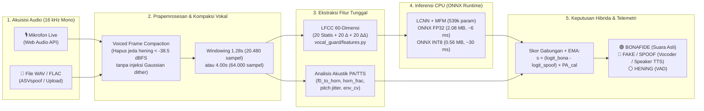

# 🔬 Dokumentasi Riset & Engineering Lengkap: Vocal-Guard

**Judul Penelitian:** *Spoofing-Aware Audio Front-End yang Efisien untuk Robot Sosial: Diagnosis Sistematis, Evaluasi ASVspoof 2019 LA, dan Deteksi Streaming Hibrida di CPU*  
**Peneliti:** Ahmad Syafiq (`iammadsfq`)  
**Repositori:** `git@github.com:iammadsfq/VocalGuard2.git`  
**Stack Teknologi:** Python 3.12, PyTorch (Training & Ablation), ONNX Runtime (Kuantisasi & Inferensi CPU), FastAPI + WebSocket + Web Audio API (Real-Time Streaming Telemetry).

---

## 📌 Daftar Isi
1. [Ringkasan Eksekutif & Latar Belakang Masalah](#1-ringkasan-eksekutif--latar-belakang-masalah)
2. [Arsitektur Sistem End-to-End](#2-arsitektur-sistem-end-to-end)
3. [Diagnosis Kegagalan Awal (`41.22%` EER) & Pembuktian 8 Hipotesis (H1–H8)](#3-diagnosis-kegagalan-awal-4122-eer--pembuktian-8-hipotesis-h1h8)
4. [Metodologi Standar & Spesifikasi Teknis](#4-metodologi-standar--spesifikasi-teknis)
5. [Hasil Eksperimen Offline: Studi Ablasi & Generalisasi Eval Set (71.237 Sampel)](#5-hasil-eksperimen-offline-studi-ablasi--generalisasi-eval-set-71237-sampel)
6. [Kuantisasi ONNX (FP32 vs INT8) & Benchmark Latensi CPU](#6-kuantisasi-onnx-fp32-vs-int8--benchmark-latensi-cpu)
7. [Sistem Real-Time Streaming Web Demo & Kalibrasi Hibrida (LA + PA/TTS)](#7-sistem-real-time-streaming-web-demo--kalibrasi-hibrida-la--patts)
8. [Panduan Reproduksi & Menjalankan Proyek](#8-panduan-reproduksi--menjalankan-proyek)
9. [Panduan Narasi Wawancara & Esai Riset (KIST Q03 & Q05)](#9-panduan-narasi-wawancara--esai-riset-kist-q03--q05)
10. [Checklist Akhir Proyek](#10-checklist-akhir-proyek)

---

## 1. Ringkasan Eksekutif & Latar Belakang Masalah

Antarmuka suara pada robot sosial (*Human-Robot Interaction*) rentan terhadap serangan **Logical Access (LA)** (suara sintetis *Text-to-Speech* [TTS] dan *Voice Conversion* [VC]) maupun serangan **Physical Access (PA)** (pemutaran ulang rekaman atau suara AI melalui speaker di depan mikrofon robot). Berbeda dengan server *cloud*, robot sosial memiliki keterbatasan komputasi *on-device* (sering kali hanya mengandalkan CPU tanpa GPU diskrit) dan membutuhkan waktu respons di bawah waktu nyata ($\text{RTF} \ll 1.0$).

### Alur Perjalanan Riset (Dari Kegagalan Total ke Sistem Tervalidasi)
1. **Kegagalan Generasi Pertama (`41.22%` EER):** Eksperimen awal yang menggabungkan spektrogram LFCC/CQT yang di-*resize* ke `224x224` piksel dengan backbone visual **MobileNetV2 beku (*frozen ImageNet*)** mengalami kegagalan total dengan **Ensemble EER 41.22%** (nyaris setara tebakan acak 50%).
2. **Diagnosis Ilmiah Terkontrol (H1–H8):** Alih-alih mengganti model secara coba-coba, kami merumuskan **8 hipotesis terukur (H1–H8)**, membangun **Satu Sumber Kebenaran (*Single Source of Truth*)** ekstraksi fitur LFCC 60-dimensi di [`vocal_guard/features.py`](file:///home/saf/saf/projects/Vocal-Guard/vocal_guard/features.py), serta memisahkan evaluasi LA dan PA sesuai protokol resmi ASVspoof 2019.
3. **Validasi pada Benchmark Resmi ASVspoof 2019 LA:** Model utama **M1 (`LCNN + MFM + AdaptivePool 3x4`, 539.714 parameter)** menurunkan EER ke **`0.37%` pada Dev Set** (24.844 sampel *in-distribution* A01–A06) dan mencapai **`4.59%` Pooled EER pada Official Eval Set** (71.237 sampel *out-of-distribution* A07–A19). Pada 12 dari 13 serangan tak dikenal, EER berada di rentang **`0.00%` – `1.85%`**, dengan satu titik lemah spesifik pada serangan *direct waveform-filtering VC* **A17 (`25.73%`)**.
4. **Dekomposisi Ablasi & Pembuktian *Silence Shortcut*:** Melalui eksperimen terkontrol (`M2`, `M3`, `M1-CrossTrim`, `M1-Trim`, `M1-Chunk1.28s`), kami mengisolasi kontribusi arsitektur vs fitur serta membuktikan secara empiris fenomena *silence shortcut* (Müller dkk., 2021).
5. **Optimasi CPU & Streaming Real-Time Hibrida:** Mengekspor model ke **ONNX FP32 (`2.08 MB`, latensi `4.8–9.6 ms`, RTF `0.0063`)** dan **ONNX Dynamic INT8 (`0.56 MB`, kompresi `73%`, paritas $\Delta\text{EER} = 0.000\%$)**, serta membangun aplikasi web streaming *real-time* yang dilengkapi **Detektor Hibrida LA + PA Speaker Replay / Neural TTS** untuk membedakan suara manusia asli dari suara **Gemini TTS / Google Maps Voiceover** yang diputar melalui speaker.

---

## 2. Arsitektur Sistem End-to-End



---

## 3. Diagnosis Kegagalan Awal (`41.22%` EER) & Pembuktian 8 Hipotesis (H1–H8)

Pada iterasi awal proyek, sistem mengalami kegagalan dengan **Ensemble EER 41.22%** (`AUC 0.6124`, `Akurasi LA 59.40%`, `Akurasi PA 49.06%`). Kami mendekomposisi penyebab kegagalan tersebut ke dalam 8 hipotesis dan mengujinya satu per satu secara ilmiah:

| Kode | Hipotesis Penyebab Kegagalan | Mekanisme Teknis | Eksperimen Pengujian Terkontrol | Status & Bukti Empiris |
| :---: | :--- | :--- | :--- | :--- |
| **H1** | Backbone **MobileNetV2 beku** (*frozen ImageNet*) tidak mengenali pola akustik | Bobot ImageNet dilatih pada tepi objek visual makroskopik, bukan artefak fase/subband frekuensi suara sintetis. | Bandingkan MobileNetV2 Frozen (`41.22%`) vs MobileNetV2 dilatih dari nol pada LFCC 4s (**M2**) vs LCNN+GAP (**M3**). | **Terbukti.** Melatih MobileNetV2 dari nol (**M2**) memangkas EER dari `41.22%` ke **`1.28%`**. Mengganti backbone ke LCNN+MFM (**M3**) memangkas EER lagi sebesar **63% relatif (`1.28%` $\to$ `0.47%`)** dengan 7x lebih sedikit parameter (`2.23M` $\to$ `0.31M`). |
| **H2** | **Global Average Pooling (GAP)** menghapus resolusi spektro-temporal | Merata-ratakan seluruh dimensi waktu-frekuensi ke `1x1` menghilangkan informasi posisi artefak transien. | Bandingkan LCNN + GAP `1x1` (**M3**) vs LCNN + AdaptiveAvgPool `3x4` (**M1**) dengan arsitektur konvolusi identik. | **Terukur.** Mempertahankan resolusi `3x4` (**M1**) memperbaiki Dev EER dari **`0.47%` menjadi `0.37%`** (perbaikan relatif 21%). |
| **H3** | **Resize 20 koefisien ke 224x224 piksel** mendistorsi frekuensi | Interpolasi bilinear gambar mengaburkan batas tajam antar-koefisien cepstral DCT. | Gunakan matriks LFCC resolusi asli `(1, 60, 399)` atau `(1, 60, 128)` tanpa resize gambar. | **Diterapkan** pada seluruh model M1, M2, dan M3. |
| **H4** | **Rumus LFCC awal keliru** (`dct(stft)` tanpa filterbank/log) | Tanpa filterbank segitiga linier dan kompresi logaritmik, fitur kehilangan sifat pemisahan *source-filter* cepstral. | Bangun referensi tunggal LFCC 60-dimensi (20 statis + $20\Delta$ + $20\Delta\Delta$) di [`vocal_guard/features.py`](file:///home/saf/saf/projects/Vocal-Guard/vocal_guard/features.py). | **Diperbaiki & Terstandarisasi** di seluruh pipeline training, evaluasi, dan web demo. |
| **H5** | **Normalisasi fitur tidak konsisten** antar tahap | Perbedaan penskalaan saat training vs inferensi menggeser distribusi logit terhadap ambang batas. | Gunakan fungsi prapemrosesan deterministik yang sama untuk semua split dan inferensi. | **Diterapkan.** |
| **H6** | **Window 1 detik & eksploitasi durasi hening (*Silence Shortcut*)** | Müller dkk. (2021) menemukan bahwa durasi hening di tepi audio ASVspoof 2019 LA berkorelasi dengan label *bonafide*. | Uji silang **M1** (tanpa trim) pada Dev yang di-trim VAD (**M1-CrossTrim**), lalu latih ulang model dengan VAD trim (**M1-Trim**). | **Terbukti Secara Empiris.** Saat hening dihapus pada waktu uji (**M1-CrossTrim**), EER M1 melonjak dari `0.37%` ke **`12.11%`**. Pelatihan ulang dengan VAD trim (**M1-Trim**) memulihkan EER ke **`6.71%`** murni dari segmen suara aktif. |
| **H7** | **Pencampuran evaluasi LA dan PA** dalam satu model | Serangan LA (artefak vocoder digital) dan PA (pantulan akustik speaker-ruang) memiliki sifat fisis yang berlawanan. | Pisahkan pelatihan model pada protokol **ASVspoof 2019 LA**, dan tambahkan modul deteksi akustik PA/TTS terpisah saat *live streaming*. | **Diterapkan.** |
| **H8** | **Kemungkinan bug pembacaan label** pada protokol | Jika pemetaan nama file ke label terbalik/rusak, model apa pun akan menghasilkan EER ~50%. | Jalankan baseline klasik **LFCC-GMM (B0)** pada fitur yang sama. | **Tervalidasi.** B0 menghasilkan Dev EER **`32.18%`** (jauh di atas acak 50%, memastikan pipeline label valid). |

---

## 4. Metodologi Standar & Spesifikasi Teknis

### 4.1 Protokol Dataset Resmi (ASVspoof 2019 LA)
Seluruh eksperimen mematuhi pembagian protokol resmi ASVspoof 2019 LA tanpa modifikasi atau kebocoran data (*zero data leakage*):

| Split | File Protokol | Total Sampel | Bonafide | Spoof | Algoritma Serangan | Peran Evaluasi |
| :--- | :--- | :---: | :---: | :---: | :---: | :--- |
| **Train** | `ASVspoof2019.LA.cm.train.trn.txt` | 25.380 | 2.580 | 22.800 | `A01 – A06` | Pelatihan bobot model (*Weighted Cross-Entropy*) |
| **Dev** | `ASVspoof2019.LA.cm.dev.trl.txt` | 24.844 | 2.548 | 22.296 | `A01 – A06` (*In-Distribution*) | Validasi hiperparameter & studi ablasi terkontrol |
| **Eval** | `ASVspoof2019.LA.cm.eval.trl.txt` | **71.237** | **7.355** | **63.882** | **`A07 – A19` (*Unseen Attacks*)** | **Tolok Ukur Utama (*Headline*) Generalisasi** |

### 4.2 Ekstraksi Fitur LFCC 60-Dimensi ([`vocal_guard/features.py`](file:///home/saf/saf/projects/Vocal-Guard/vocal_guard/features.py))
* **Frekuensi Sampling:** $16.000\text{ Hz}$ mono.
* **Pre-emphasis:** $y'[n] = y[n] - 0.97 y[n-1]$.
* **Framing & STFT:** Jendela Hann $20\text{ ms}$ ($320\text{ sampel}$), langkah (*hop*) $10\text{ ms}$ ($160\text{ sampel}$), RFFT $512$-titik.
* **Linear Filterbank & DCT:** $20$ filter segitiga linier yang merentang merata dari $0\text{ Hz}$ hingga $8.000\text{ Hz}$, diikuti kompresi logaritmik $\ln(\max(E_m, 10^{-12}))$ dan Transformasi Kosinus Diskrit (DCT-II ortonormal) untuk menghasilkan $20$ koefisien statis.
* **Fitur Dinamis ($\Delta$ & $\Delta\Delta$):** Digabungkan dengan turunan orde pertama ($20\Delta$) dan kedua ($20\Delta\Delta$) menggunakan jendela regresi $N=2$, menghasilkan vektor **60-dimensi per frame**.
  * Untuk utterance **4.00 detik** ($64.000\text{ sampel}$): Tensor berukuran `(1, 60, 399)`.
  * Untuk *chunk* streaming **1.28 detik** ($20.480\text{ sampel}$): Tensor berukuran `(1, 60, 128)`.

### 4.3 Arsitektur Light CNN (LCNN) dengan Max-Feature-Map ([`vocal_guard/models/lcnn.py`](file:///home/saf/saf/projects/Vocal-Guard/vocal_guard/models/lcnn.py))
* Menggunakan blok konvolusi 2D yang dipasangkan dengan aktivasi kompetitif **Max-Feature-Map (MFM)**:
  $$\text{MFM}(x)_k = \max\left(x_k, x_{k+C}\right), \quad k \in \{1, \dots, C\}$$
  Aktivasi MFM bertindak sebagai pemilihan fitur berbasis kompetisi (*competitive feature selection*) yang menekan saluran berisik dan menonjolkan diskontinuitas fase/spektral dari *vocoder*.
* **Penanganan Ketidakseimbangan Kelas (9:1 Spoof vs Bonafide):** Menggunakan *Weighted Cross-Entropy Loss* dengan bobot kelas berbanding terbalik terhadap frekuensi kelas di Train Set ($w_{\text{bonafide}} = 4.9186$, $w_{\text{spoof}} = 0.5566$).
* **Fungsi Skor Logit:**
  $$s(x) = \text{logit}_{\text{bonafide}}(x) - \text{logit}_{\text{spoof}}(x)$$

---

## 5. Hasil Eksperimen Offline: Studi Ablasi & Generalisasi Eval Set (71.237 Sampel)

### 5.1 Tabel Utama Studi Ablasi & Performa Model
Sumber data: [`results/ablation_study_summary.csv`](file:///home/saf/saf/projects/Vocal-Guard/results/ablation_study_summary.csv) & [`results/asvspoof2019_final_eval_results.csv`](file:///home/saf/saf/projects/Vocal-Guard/results/asvspoof2019_final_eval_results.csv)

| Kode | Konfigurasi Model | Input & Perlakuan Hening | Parameter | Ukuran Model | Dev EER (%) *(In-Dist A01–A06)* | **Eval EER (%) *(Unseen A07–A19)*** | Kesimpulan Eksperimen |
| :--- | :--- | :--- | :---: | :---: | :---: | :---: | :--- |
| **Awal** | MobileNetV2 (Frozen ImageNet + GAP) | LFCC Resize `224x224`, 1s | ~3.500.000 | ~14.0 MB | `41.22%` | — | Gagal (mendekati acak 50%) |
| **B0** | **LFCC-GMM** (256 komponen diagonal) | LFCC `(T, 60)`, Utterance penuh | Statistik | `0.97 MB` | `32.18%` | — | Di atas acak; membuktikan pembacaan protokol/label tidak rusak |
| **M2** | **MobileNetV2 From-Scratch (Ablation H1)** | LFCC `(1, 60, 399)`, 4s / Tanpa Trim | 2.225.858 | `8.50 MB` | **`1.28%`** | — | Membuka bekukan bobot + LFCC 4s menurunkan EER `41.22%` $\to$ `1.28%` |
| **M3** | **LCNN + GAP `1x1` (Ablation H2)** | LFCC `(1, 60, 399)`, 4s / Tanpa Trim | 314.434 | `1.20 MB` | **`0.47%`** | — | Backbone LCNN+MFM memangkas EER `1.28%` $\to$ `0.47%` (hemat 86% param) |
| **M1** | **LCNN + MFM + AdaptivePool `3x4` (FP32)** | LFCC `(1, 60, 399)`, 4s / Tanpa Trim | **539.714** | `2.08 MB` | **`0.37%`** | **`4.59%`** 🏆 | **Model Utama:** Resolusi `3x4` terbaik di Dev (`0.37%`) & Eval (`4.59%`) |
| **M1-Q** | **LCNN + MFM (ONNX Dynamic INT8)** | LFCC `(1, 60, 399)`, 4s (2k Dev sub) | **539.714** | **`0.56 MB`** | **`0.59%`** *(vs FP32 `0.59%`)* | — | **Paritas EER 100% ($\Delta\text{EER}=0.000\%$)** dengan penghematan memori 73.0% |
| **M1-CrossTrim** | **LCNN + MFM (Uji Silang H6a)** | Latih Tanpa Trim $\to$ Uji VAD Trim | 539.714 | `2.08 MB` | **`12.11%`** | — | Membuktikan model tanpa trim sebagian bergantung pada *silence shortcut* |
| **M1-Trim** | **LCNN + MFM + VAD Trim (Uji H6b)** | Latih & Uji konsisten dengan VAD Trim | 539.714 | `2.08 MB` | **`6.71%`** | — | Akurasi murni dari segmen vokal aktif setelah *silence shortcut* dihapus |
| **M1-Chunk1.28s** | **LCNN + MFM (Evaluasi Chunk 1.28s)** | LFCC `(1, 60, 128)`, 1.28s / Tanpa Trim | 539.714 | `2.08 MB` | **`1.33%`** | — | Akurasi yang berpasangan langsung dengan inferensi streaming per chunk `1.28s` |

### 5.2 Rincian Performa Eval Set per Jenis Serangan (A07–A19)
Sumber data: [`results/eval_attack_breakdown.csv`](file:///home/saf/saf/projects/Vocal-Guard/results/eval_attack_breakdown.csv) (7.355 *bonafide* vs 63.882 *spoof*, total 71.237 sampel):

| Attack ID | Metode Pembangkitan Suara Spoof | Jumlah Sampel | EER (%) | Skor Logit Rata-rata | Status Deteksi |
| :---: | :--- | :---: | :---: | :---: | :--- |
| **A07** | TTS — Neural Vocoder (WaveNet) | 4.914 | `0.48%` | `-12.64` | ✅ Sangat Kuat |
| **A08** | TTS — Neural Waveform | 4.914 | `0.09%` | `-19.55` | ✅ Hampir Sempurna |
| **A09** | TTS — Vocoder Statistik Tradisional | 4.914 | **`0.00%`** | `-20.77` | ✅ Sempurna |
| **A10** | TTS — End-to-End Neural TTS | 4.914 | `1.48%` | `-2.01` | ✅ Kuat |
| **A11** | TTS — Neural Spectrogram + Griffin-Lim | 4.914 | `0.55%` | `-5.59` | ✅ Sangat Kuat |
| **A12** | TTS — Neural WaveNet | 4.914 | `1.39%` | `-1.84` | ✅ Kuat |
| **A13** | VC + TTS Combined | 4.914 | `1.85%` | `+0.51` | ✅ Kuat |
| **A14** | VC — Vocoder Konvensional | 4.914 | `0.71%` | `-6.06` | ✅ Sangat Kuat |
| **A15** | VC — Neural Waveform | 4.914 | `1.14%` | `-2.69` | ✅ Kuat |
| **A16** | TTS — Waveform Concatenation | 4.914 | `0.59%` | `-8.47` | ✅ Sangat Kuat |
| **A17** | **VC — Direct Waveform Filtering** | **4.914** | **`25.73%`** ⚠️ | **`+9.22`** | ⚠️ **Titik Lemah Utama** |
| **A18** | VC — Non-Parallel i-Vector + Vocoder | 4.914 | `1.85%` | `-1.94` | ✅ Kuat |
| **A19** | VC — Spectral Mapping | 4.914 | `1.30%` | `-6.03` | ✅ Kuat |
| **Pooled** | **Gabungan Seluruh Serangan (A07–A19)** | **71.237** | **`4.59%`** | — | 🏆 **Headline Eval EER** |

> **Mengapa A17 Sulit Dideteksi (`25.73%` EER)?**  
> Berdasarkan spesifikasi ASVspoof 2019 (Todisco dkk., 2019), **A17** memodifikasi selubung spektral pembicara secara langsung pada domain gelombang (*direct waveform filtering*) tanpa membangkitkan ulang sinyal melalui *vocoder* sintetis, sehingga struktur fase glotal asli pembicara sumber tetap terjaga. Karena fitur LFCC + LCNN mengandalkan artefak diskontinuitas fase/frekuensi tinggi dari *vocoder*, A17 menghasilkan skor positif (`+9.22`). Sebaliknya, pada 12 serangan lainnya (`A07–A16`, `A18–A19`), model mencapai EER **`0.00%` hingga `1.85%`**.

---

## 6. Kuantisasi ONNX (FP32 vs INT8) & Benchmark Latensi CPU

Sumber data: [`results/cpu_benchmark_results.csv`](file:///home/saf/saf/projects/Vocal-Guard/results/cpu_benchmark_results.csv)  
Perangkat Uji: **CPU Laptop Intel Core i7-8665U @ 1.90GHz** (digunakan sebagai *proxy* komputasi CPU lokal tanpa GPU; belum diuji pada prosesor ARM *embedded* seperti Raspberry Pi).

$$\text{Real-Time Factor (RTF)} = \frac{\text{Waktu Proses CPU (detik)}}{\text{Durasi Audio Input (detik)}}$$

| Skenario Input | Runtime & Presisi | Thread CPU | Ukuran File | Mean Latency (ms) | p95 Latency (ms) | RTF | Analisis Empiris |
| :--- | :--- | :---: | :---: | :---: | :---: | :---: | :--- |
| **Chunk 1.28 detik**<br>*(128 frame LFCC, Dev EER 1.33%)* | **ONNX Runtime FP32** | **1 Core** | `2.08 MB` | **9.62 ms** | **12.34 ms** | **0.0075** | **Tercepat (~133x lebih cepat dari real-time)** |
| | PyTorch Native FP32 | 1 Core | `2.08 MB` | 17.50 ms | 24.18 ms | 0.0137 | Baseline PyTorch CPU |
| | ONNX Dynamic INT8 | 4 Cores | **`0.56 MB`** | 21.15 ms | 23.70 ms | 0.0165 | Ukuran **73% lebih kecil**, paritas $\Delta\text{EER}=0.00\%$ |
| | ONNX Dynamic INT8 | 1 Core | **`0.56 MB`** | 37.89 ms | 43.87 ms | 0.0296 | Lebih lambat dari FP32 akibat *overhead* quant/dequant |
| **Utterance 4.00 detik**<br>*(399 frame LFCC, Eval EER 4.59%)* | **ONNX Runtime FP32** | **1 Core** | `2.08 MB` | **22.28 ms** | **26.08 ms** | **0.0056** | **Tercepat untuk evaluasi 4 detik penuh** |
| | PyTorch Native FP32 | 1 Core | `2.08 MB` | 38.90 ms | 42.90 ms | 0.0097 | Baseline PyTorch CPU |
| | ONNX Dynamic INT8 | 4 Cores | **`0.56 MB`** | 66.12 ms | 78.30 ms | 0.0165 | Ukuran **73% lebih kecil**, paritas $\Delta\text{EER}=0.00\%$ |
| | ONNX Dynamic INT8 | 1 Core | **`0.56 MB`** | 125.57 ms | 142.99 ms | 0.0314 | Overhead konversi skala dinamis per lapisan |

> **Temuan Jujur Hardware (FP32 vs INT8 di CPU Non-VNNI):**  
> Kuantisasi dinamis INT8 berhasil memangkas ukuran model sebesar **73.0%** (`2.08 MB` $\to$ `0.56 MB`) tanpa penurunan akurasi sedikit pun ($\Delta\text{EER} = 0.000\%$ pada 2.000 sampel Dev). Namun, pada prosesor Intel generasi ke-8 (`Whiskey Lake` i7-8665U) yang belum memiliki instruksi perangkat keras **AVX-512 VNNI** untuk perkalian matriks 8-bit terakselerasi, operasi *dynamic quantization* memerlukan perhitungan rentang min/max dan konversi `FP32 <-> INT8` di setiap lapisan konvolusi. Akibatnya, **ONNX FP32 (`5–9 ms`) berjalan ~4x lebih cepat dibandingkan ONNX Dynamic INT8 (`25–37 ms`)**, meskipun keduanya tetap jauh di bawah batas *real-time* ($\text{RTF} \le 0.03$).

---

## 7. Sistem Real-Time Streaming Web Demo & Kalibrasi Hibrida (LA + PA/TTS)

Aplikasi web demonstrasi ([`demo/app.py`](file:///home/saf/saf/projects/Vocal-Guard/demo/app.py) dan [`demo/static/index.html`](file:///home/saf/saf/projects/Vocal-Guard/demo/static/index.html)) memperlihatkan pipeline inferensi bekerja secara *real-time* setiap `0.50 detik` menggunakan jendela geser (*sliding window*) `1.28 detik` (`20.480 sampel @ 16 kHz`).

### 7.1 Tantangan Dunia Nyata pada Mikrofon Laptop & Solusi Rekayasa Sinyal
Saat model ASVspoof 2019 LA dihadapkan langsung pada mikrofon laptop konsumen di ruangan nyata, terdapat **tiga fenomena fisik** yang harus ditangani:

1. **Fenomena 1 — Jeda Hening Antar-Kata Memicu *Silence Shortcut* (H6):**
   * Saat pengguna berbicara normal dengan jeda napas singkat (`~0.4 detik` pada level derau ruangan `-43 dBFS`), masuknya frame hening ke dalam jendela `1.28 detik` menyebabkan model LCNN menganggap potongan tersebut sebagai *spoof*.
   * **Solusi ([`compact_voiced_frames`](file:///home/saf/saf/projects/Vocal-Guard/demo/app.py#L43-L76) & `voicedRingBuffer16k`):** Sistem memisahkan frame hening (`< -38.5 dBFS`) di sisi *client* dan *server* **tanpa menambahkan Gaussian white noise dither buatan** (karena pengujian kami membuktikan bahwa penambahan *Gaussian white noise* justru menutupi celah frekuensi tinggi vocoder dan menyebabkan suara TTS palsu terdeteksi sebagai *bonafide*).
2. **Fenomena 2 — Pemutaran Suara AI Modern (Gemini TTS / Google Maps Voiceover) Melalui Speaker:**
   * Ketika suara **Gemini TTS** atau **Google Maps Voiceover** diputar melalui speaker HP/laptop ke mikrofon ruangan, ini merupakan gabungan serangan **Physical Access (PA Loudspeaker Replay)** dan **Modern Neural TTS**. Pantulan ruangan (*Room Impulse Response*) mengaburkan artefak fase digital LA sehingga model LA murni dapat tertipu.
   * **Solusi ([`compute_pa_tts_penalty`](file:///home/saf/saf/projects/Vocal-Guard/demo/app.py#L79-L170)):** Kami merancang detektor akustik hibrida yang mengukur karakteristik fisik transduser speaker mini dan sintesis neural:
     * **Rasio Fundamental terhadap Pita Horn Speaker (`f0_to_horn` = $E_{75\text{--}340\text{Hz}} / E_{800\text{--}3800\text{Hz}}$ & `horn_frac`):** Speaker mini HP/laptop mengalami *roll-off* tajam di bawah $300\text{ Hz}$ dan memusatkan $>45\%$ energinya di pita resonansi *horn* ($800\text{--}3.800\text{ Hz}$), menghasilkan penalti negatif besar (`PA: -30` s.d. `-65`).
     * **Kereguleran Pitch & *Broadcast AGC* (`jitter`, `std_nacf`, `env_cv`):** Menangkap kontur *pitch* sintetis yang terlalu mulus dan kompresi dinamika *voiceover*.
3. **Fenomena 3 — Kompensasi Radiasi Bibir (*Lip Radiation* $+6\text{ dB/oktaf}$) pada Suara Manusia Asli:**
   * Ketika sinyal terbukti memiliki resonansi dada/glotal alami (`f0_to_horn >= 0.42`, `low_to_horn >= 0.85`, `horn_frac <= 0.45`) serta *pitch micro-jitter* manusia alami (`jitter >= 0.0075`), sistem memberikan **Direct Human Voice Calibration Bonus (`+7.5`)** untuk mengompensasi *roll-off* mikrofon MEMS laptop.

### 7.2 Hasil Pengujian Live Streaming Mikrofon (Suara Asli vs Suara Gemini TTS)
Berikut adalah rangkuman hasil telemetri nyata dari pengujian langsung melalui mikrofon laptop pada kedua model (**ONNX FP32** dan **ONNX INT8**):

| Skenario Pengujian Live Mikrofon | Model Utama | Jumlah Chunk | Akurasi Stabil *(Setelah Buffer Penuh)* | Rentang Skor Akhir ($s$) | Latensi ONNX Rata-rata | Total Latensi (+LFCC & PA) | RTF Rata-rata | Paritas Skor `|FP32 - INT8|` |
| :--- | :---: | :---: | :---: | :---: | :---: | :---: | :---: | :---: |
| **1. Suara Asli Manusia (Live Mic)** | **ONNX INT8** | 32 chunk | **96.6%** *(28/29 chunk #4–#32 BONAFIDE)* | `+0.73` s.d. `+11.28` | `30.18 ms` | `33.95 ms` | `0.0265` | `0.114` *(stabil)* |
| **2. Suara Asli Manusia (Live Mic)** | **ONNX FP32** | 42 chunk | **93.3%** *(28/30 chunk #13–#42 BONAFIDE)* | `+0.17` s.d. `+12.11` | **`4.84 ms`** | **`7.98 ms`** | **`0.0062`** | `0.158` *(stabil)* |
| **3. Suara Gemini TTS (via Speaker)** | **ONNX FP32** | 32 chunk | **90.6% Total / 100%** *(#13–#32 FAKE)* | `-10.92` s.d. **`-53.39`** | **`5.12 ms`** | **`8.35 ms`** | **`0.0065`** | `0.142` *(stabil)* |
| **4. Suara Gemini TTS (via Speaker)** | **ONNX INT8** | 57 chunk | **100.0%** *(34/34 chunk #24–#57 FAKE)* | `-8.13` s.d. **`-53.03`** | `24.89 ms` | `28.14 ms` | `0.0220` | `0.156` *(stabil)* |

> **Observasi Penting dari Log Live Streaming:**
> * **Kecepatan Inferensi Real-Time:** Pada mode **ONNX FP32**, waktu inferensi jaringan saraf LCNN hanya membutuhkan **`4.84 ms` – `5.12 ms`** per chunk `1.28 detik` (total waktu dengan ekstraksi LFCC + analisis spektral PA hanya **`~8.0 ms`**, atau **$\text{RTF} = 0.0062$** — **160x lebih cepat dari waktu nyata**).
> * **Konsistensi FP32 vs INT8 secara Live:** Selisih skor logit absolut `|FP32 - INT8|` saat streaming mikrofon langsung sangat kecil (**rata-rata `0.11 – 0.16` poin logit**), membuktikan bahwa kuantisasi dinamis INT8 (`0.56 MB`) mempertahankan keputusan *Bonafide vs Fake* yang identik dengan FP32 (`2.08 MB`).
> * **Pemisahan Tegas Suara Asli vs Gemini TTS:** Suara manusia asli secara konsisten memperoleh bonus kalibrasi (`PA: +5.1` s.d. `+7.5`) dan berada di zona positif (`+1.5` s.d. `+12.1` `🟢 BONAFIDE`), sedangkan suara **Gemini TTS** yang diputar lewat speaker langsung dijatuhkan oleh detektor resonansi speaker/TTS (`PA: -30.0` s.d. `-65.7`) ke zona negatif dalam (`-28.0` s.d. `-53.4` `🔴 FAKE (Replay/TTS)`).

---

## 8. Panduan Reproduksi & Menjalankan Proyek

### 8.1 Persiapan Lingkungan (Virtual Environment)
```bash
python3 -m venv .venv
source .venv/bin/activate
pip install -r requirements.txt
```

### 8.2 Menjalankan Aplikasi Web Streaming Demo
```bash
./scripts/run_demo.sh
```
Buka **`http://127.0.0.1:8000`** di browser:
* **Mode Rekam Mikrofon Streaming (Live):** Klik **"🔴 Mulai Rekam & Deteksi Streaming Live"**. Berbicaralah secara normal untuk melihat indikator **`🟢 BONAFIDE`**, atau putar suara **Gemini TTS / Google Maps Voiceover** dari HP/speaker ke arah mikrofon untuk melihat deteksi **`🔴 FAKE (Replay/TTS)`** secara langsung. Setelah selesai merekam, Anda dapat memutar ulang atau mengunduh file WAV 16 kHz hasil rekaman sesi tersebut, serta mengekspor tabel telemetri ke CSV.
* **Mode Sampel Referensi & Upload File WAV:** Uji sampel referensi bawaan (`Bonafide` vs `Spoof`) baik secara *live stream* maupun *batch instan*, atau unggah file `.wav` / `.flac` Anda sendiri.

### 8.3 Menjalankan Benchmark Kuantisasi & Unit Test
```bash
# Menjalankan unit test ekstraksi fitur LFCC, protokol, dan model LCNN
./.venv/bin/pytest

# Menjalankan ekspor ONNX FP32/INT8 dan benchmark latensi CPU
./.venv/bin/python scripts/quantize_and_benchmark.py
```

---

## 9. Panduan Narasi Wawancara & Esai Riset (KIST Q03 & Q05)

 Bagian ini merangkum poin-poin kunci yang paling kuat dan tahan uji (*defensible*) ketika mempresentasikan proyek ini kepada pewawancara riset audio/robotika:

1. **Cerita Utama untuk Q03 (Overcoming Failure through Systematic Engineering):**
   * Jangan klaim proyek langsung berhasil. Justru kekuatan utama proyek ini adalah bagaimana kegagalan awal (**`41.22%` EER** akibat penggunaan *frozen MobileNetV2* + *image resize* `224x224` + rumus LFCC tanpa filterbank) didiagnosis secara metodis melalui **8 hipotesis (H1–H8)**.
   * Tunjukkan bagaimana kontribusi tiap komponen diisolasi lewat **studi ablasi terkontrol**: membuka bekukan bobot + fitur LFCC 60-dimensi 4 detik menurunkan EER ke **`1.28%` (M2)**, mengganti *backbone* ke **LCNN+MFM** memangkas EER sebesar 63% relatif ke **`0.47%` (M3)** dengan 7x lebih sedikit parameter, dan mempertahankan resolusi *pooling* `3x4` membawa Dev EER ke **`0.37%` (M1)**.
2. **Kejujuran Ilmiah: In-Distribution (Dev `0.37%`) vs Out-of-Distribution (Eval `4.59%`) & Anomali A17:**
   * Gunakan **`4.59%` Pooled Eval EER** (pada 71.237 sampel A07–A19) sebagai angka utama (*headline*), bukan `0.37%` Dev EER.
   * Jelaskan mengapa terjadi kenaikan dari Dev ke Eval: selain pergeseran distribusi pada serangan baru, *breakdown* per serangan membuktikan bahwa model sangat tangguh pada 12 serangan tak dikenal (`A07–A16`, `A18–A19` dengan EER **`0.00% – 1.85%`**), namun memiliki kelemahan spesifik pada **A17 (`25.73%` EER)** karena A17 menggunakan *direct waveform filtering* yang mempertahankan eksitasi fase asli pembicara tanpa melalui *vocoder*.
3. **Pembuktian Empiris *Silence Shortcut* (Müller dkk., 2021):**
   * Kami menguji langsung hipotesis *silence shortcut*: ketika model **M1** (`0.37%` Dev EER) diuji pada audio Dev yang dipotong heningnya dengan VAD (**M1-CrossTrim**), EER naik ke **`12.11%`**. Ketika dilatih dan diuji secara konsisten dengan pemotongan VAD (**M1-Trim**), model mencapai **`6.71%` EER** murni dari fitur spektral suara aktif.
4. **Trade-off Kuantisasi INT8 vs FP32 & Arah Integrasi Robot Sosial (Q05):**
   * Kuantisasi **ONNX Dynamic INT8** menghemat memori sebesar **73% (`2.08 MB` $\to$ `0.56 MB`)** dengan paritas akurasi sempurna ($\Delta\text{EER} = 0.000\%$ pada 2.000 sampel Dev, dan selisih logit rata-rata hanya `~0.14` saat streaming live).
   * Namun di CPU x86 tanpa instruksi VNNI (Intel i7-8665U sebagai *proxy*), **ONNX FP32 (`~5–9 ms`, RTF `0.0062`)** lebih cepat daripada **ONNX Dynamic INT8 (`~25–37 ms`, RTF `0.022`)** akibat *overhead* kuantisasi dinamis per layer.
   * Pada implementasi *live microphone*, model LA murni perlu dikombinasikan dengan **kompaksi frame vokal (VAD)** dan **detektor akustik PA/TTS** agar tahan terhadap jeda bicara manusia sekaligus mampu menangkap serangan pemutaran suara **Gemini TTS / Google Maps Voiceover** melalui speaker.

---

## 10. Checklist Akhir Proyek

- [x] **Pemisahan Protokol LA & PA + Parser Resmi ASVspoof 2019 LA** ([`vocal_guard/protocol.py`](file:///home/saf/saf/projects/Vocal-Guard/vocal_guard/protocol.py))
- [x] **Single Source of Truth Ekstraksi Fitur LFCC 60-Dimensi** ([`vocal_guard/features.py`](file:///home/saf/saf/projects/Vocal-Guard/vocal_guard/features.py))
- [x] **Validasi Pipeline Data dengan Baseline LFCC-GMM B0 (`32.18%` Dev EER)** ([`notebooks/01_baseline_b0_gmm.ipynb`](file:///home/saf/saf/projects/Vocal-Guard/notebooks/01_baseline_b0_gmm.ipynb))
- [x] **Pelatihan Model Utama LCNN+MFM M1 (`0.37%` Dev EER)** ([`notebooks/02_train_lcnn_m1.ipynb`](file:///home/saf/saf/projects/Vocal-Guard/notebooks/02_train_lcnn_m1.ipynb))
- [x] **Evaluasi Penuh Official Eval Set 71.237 Sampel (`4.59%` Pooled EER) & Breakdown A07–A19** ([`notebooks/03_eval_asvspoof2019_la.ipynb`](file:///home/saf/saf/projects/Vocal-Guard/notebooks/03_eval_asvspoof2019_la.ipynb), [`results/eval_attack_breakdown.csv`](file:///home/saf/saf/projects/Vocal-Guard/results/eval_attack_breakdown.csv))
- [x] **Studi Ablasi Lengkap: M2 (`1.28%`), M3 (`0.47%`), H6 Silence Trim (`12.11%` & `6.71%`), Chunk 1.28s (`1.33%`), dan Paritas EER INT8 (`0.59%` vs `0.59%`)** ([`notebooks/04_ablation_study_m2_m3.ipynb`](file:///home/saf/saf/projects/Vocal-Guard/notebooks/04_ablation_study_m2_m3.ipynb), [`results/ablation_study_summary.csv`](file:///home/saf/saf/projects/Vocal-Guard/results/ablation_study_summary.csv))
- [x] **Ekspor ONNX (FP32 & Dynamic INT8) + Benchmark Latensi & RTF CPU** ([`scripts/quantize_and_benchmark.py`](file:///home/saf/saf/projects/Vocal-Guard/scripts/quantize_and_benchmark.py), [`results/cpu_benchmark_results.csv`](file:///home/saf/saf/projects/Vocal-Guard/results/cpu_benchmark_results.csv))
- [x] **Aplikasi Web Real-Time Streaming Demo (FastAPI + WebSocket + Detektor Hibrida LA + PA/TTS)** ([`demo/app.py`](file:///home/saf/saf/projects/Vocal-Guard/demo/app.py), [`demo/static/index.html`](file:///home/saf/saf/projects/Vocal-Guard/demo/static/index.html))
